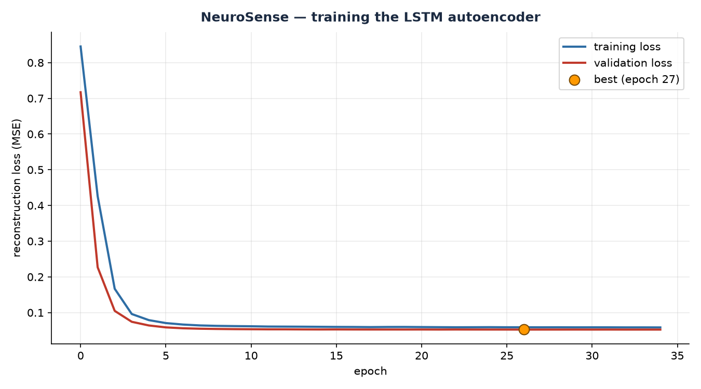

# 🧠 NeuroSense

**Deep-learning anomaly detection for sensor data — and an honest benchmark against the classical method.**

An LSTM autoencoder learns what "normal" looks like for an environment monitor, then flags readings it cannot reconstruct. It is measured head-to-head against an Isolation Forest on the same data, with the same thresholding rule, on a held-out test split.



## 📊 The result

Both models are trained on normal data only, with the alert threshold calibrated on a **validation** split, and scored on a **test** split neither has seen.

| Model | Precision | Recall | F1 |
|---|---|---|---|
| **LSTM autoencoder (deep)** | 0.649 | **1.000** | **0.787** |
| Isolation Forest (classical) | **0.862** | 0.676 | 0.758 |

*1,489 test windows, 37 of them genuinely anomalous.*

**Read this honestly.** The deep model edges ahead on F1, but only modestly — and the two behave very differently:

- The **autoencoder caught every single anomaly** (recall 1.000) but raised more false alarms (precision 0.649).
- The **Isolation Forest** was more precise (0.862) but **missed a third of the real anomalies**.

Which is "better" depends on the cost of a miss versus the cost of a false alarm. In a lab watching for equipment overheating, a miss is expensive and a false alarm is cheap — so you would choose the autoencoder. In a system that pages someone at 3am, you might choose the forest. **That trade-off is the finding**, and stating it is more useful than claiming a winner.

## 🎯 Why this project exists

Most anomaly-detection projects stop at "I used Isolation Forest". This one asks the follow-up question an interviewer will ask anyway: *does a deep model actually do better here?* Answering it properly needs a labelled benchmark, a time-ordered split, threshold calibration that does not peek at the test data, and precision/recall — not just accuracy.

## 🏗️ How it works

```
raw readings ──► sliding windows (12 readings each) ──► standardise
                                                          │
                     ┌────────────────────────────────────┘
                     ▼
        ┌────────────────────────────┐
        │   LSTM autoencoder         │   trained on NORMAL windows only
        │   encode → bottleneck(6)   │
        │   decode → reconstruct     │
        └────────────┬───────────────┘
                     ▼
        reconstruction error  ──►  above threshold  ──►  ANOMALY
```

Three design choices do the real work:

1. **The bottleneck.** Windows are squeezed through 6 numbers before being rebuilt. The network cannot copy the input through — it must keep only the patterns it learned, which is what makes it good at normal and clumsy at unusual.
2. **Train on normal only.** Anomalies are deliberately excluded from training, so the model never learns to reconstruct them.
3. **Calibrate on validation, score on test.** The threshold comes from the validation split. Tuning it on test data is the most common way people accidentally cheat and report numbers that do not hold up.

## 🚀 Quick start

```bash
pip install -r requirements.txt

python train.py       # trains the autoencoder (~20 seconds on a CPU)
python evaluate.py    # the head-to-head comparison
python detect.py --db artifacts/test_sensors.db
```

## 📁 Project structure

```
neurosense/
├── config.py        # every tunable setting, in one place
├── data.py          # labelled benchmark, windowing, scaling, time-ordered splits
├── model.py         # the LSTM autoencoder
├── train.py         # training loop: early stopping, best-weights checkpointing
├── baseline.py      # the Isolation Forest comparison
├── evaluate.py      # threshold calibration and precision/recall/F1
├── detect.py        # score real readings and report anomalies
├── tests/
└── docs/
```

## 🔬 On the benchmark

Real sensor data has no ground truth — "was this spike an anomaly?" is a judgement call — so this project builds a **labelled synthetic benchmark**. Three anomaly types a real lab actually sees are injected, at known positions:

| Type | What it looks like |
|---|---|
| **Spike** | Temperature briefly reads far too high |
| **Level shift** | Temperature drifts up and humidity down, and stays wrong |
| **Stuck sensor** | Readings freeze at one value |

Around **2% of readings** are anomalous. Because the model looks at windows, a window counts as anomalous if any reading inside it is — that is stated in the code so the number is not misleading.

This is a simulation, and it is labelled as one. It is a fair test of the *method*; it is not a claim about real hardware.

## 🔗 Using your own data

NeuroSense reads the same schema as the
[ESP32 Environment Monitor](https://github.com/gshivaprasad0009-gana/esp32-environment-monitor):

```bash
SENSOR_DB=../esp32-environment-monitor/data/sensors.db python detect.py
```

## 🧪 Tests

```bash
pytest -q
```

They check the benchmark itself (the anomaly rate, reproducibility, and that a window is labelled correctly), the time-ordered split, the model's shapes and save/load round-trip, the metrics maths against a hand-computed case, and that training actually reduces loss.

## 🎓 How to understand this code

Read in this order:

1. **`config.py`** — just settings. Read it first so the numbers mean something.
2. **`data.py`**, `_normal_series()` — a sine wave with noise. That is all "normal" is.
3. **`data.py`**, `windowise()` — turning a series into overlapping windows. Ten lines.
4. **`model.py`** — the autoencoder. `encode()` squeezes, `forward()` rebuilds.
5. **`train.py`** — the training loop: forward, loss, backward, step. That four-line pattern is all of deep learning.
6. **`evaluate.py`** — precision, recall, F1, and why the threshold comes from validation.

Steps 1–3 are beginner Python. Step 5 is the one worth staring at until it clicks.

## 🗺️ Roadmap

- [ ] A Transformer encoder to compare against the LSTM
- [ ] Per-feature reconstruction error, to say *which* sensor went wrong
- [ ] Score live data from MQTT instead of a database
- [ ] Deploy the detector on AWS (Lambda + DynamoDB)
- [ ] Quantise the model and run it on the ESP32 itself

## 📄 License

Released under the [MIT License](LICENSE).

## ✍️ Author

**Ganamolla Shiva Prasad** — B.Tech ECE student, building in Python, AI/ML, IoT
and cloud computing.
